<div align="center">

# THE SWARM

### 1,000 INDIVIDUALS. ONE INTELLIGENCE.

Ein lebender Schwarm aus 1.000 Lichtpunkten, dessen Strategie in Echtzeit von **TypeSafe Jev** entschieden wird.

[](https://www.typescriptlang.org/)
[](https://pixijs.com/)
[](https://vite.dev/)
[](https://nodejs.org/)
[](https://docs.typesafe.ai)
[](#performance)
[](LICENSE)

**Ein Projekt von [KI Boost Mittelstand](https://www.kiboostmittelstand.de)**

<br />

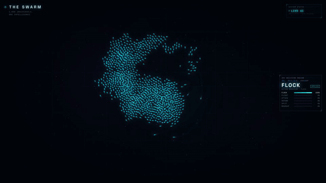

</div>

---

## Worum es geht

Tausend Individuen, kein Anführer. Jedes Lichtteilchen folgt nur einfachen lokalen Regeln. Erst zusammen entsteht ein Organismus, der flieht, angreift, sich schützt, sich teilt und wieder sammelt.

Die **strategische Ebene** übernimmt eine echte KI. Alle 1,5 Sekunden oder sofort, wenn etwas passiert, bekommt **Jev** von [TypeSafe](https://docs.typesafe.ai) einen kompakten Lagebericht und beantwortet drei Fragen:

| Frage | Primitive | Wirkung |
|---|---|---|
| Welche Strategie passt zur Lage? | `choice` | FLOCK · FLIGHT · ATTACK · DEFEND · SPLIT · REGROUP |
| Wie dringend muss der Schwarm reagieren? | `score` (0–3) | Tempo der Formationswechsel, Kraft, Glow, Energiepuls |
| Hat Energiesparen Vorrang? | `noul` | Maximalgeschwindigkeit und Energieverbrauch |

Alles, was das HUD als Jev-Wert anzeigt, stammt unverändert aus der API-Antwort. Ohne API-Key läuft die App in einem klar gekennzeichneten **Simulationsmodus**.

<p align="center">
  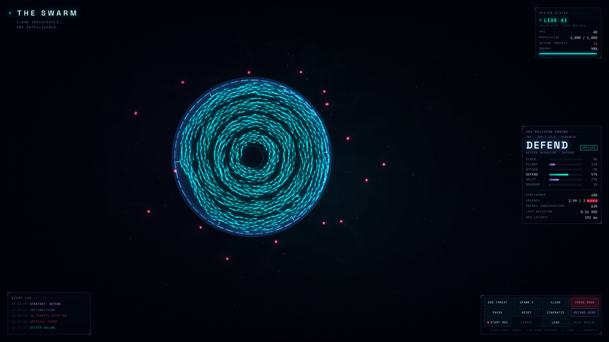
  <br />
  <sub>Live: 16 Bedrohungen tauchen auf. Jev entscheidet sich für <b>DEFEND</b> (57 %), mit Urgency 2.99 / 3 bei 193 ms Latenz.</sub>
</p>

## Sechs Strategien

<table>
  <tr>
    <td width="33%">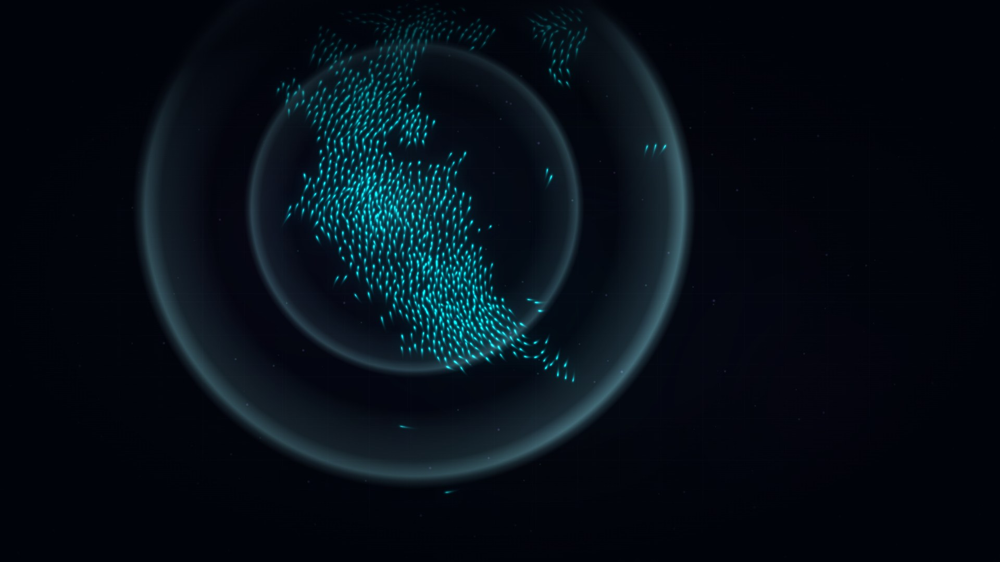<br /><b>FLOCK</b>: organische Schwarmbewegung, hohe Kohäsion</td>
    <td width="33%">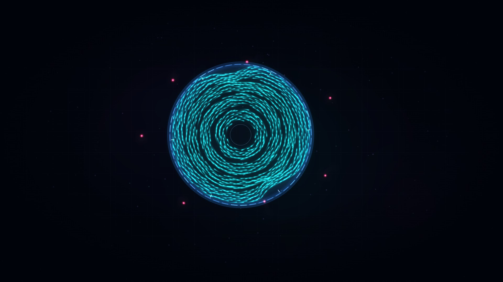<br /><b>DEFEND</b>: vier gegenläufig rotierende Ringe und eine Energiebarriere</td>
    <td width="33%">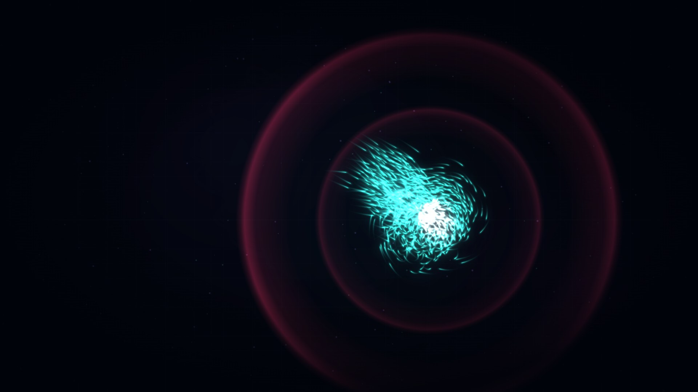<br /><b>ATTACK</b>: Wirbel um das Ziel, bis es explodiert</td>
  </tr>
  <tr>
    <td width="33%">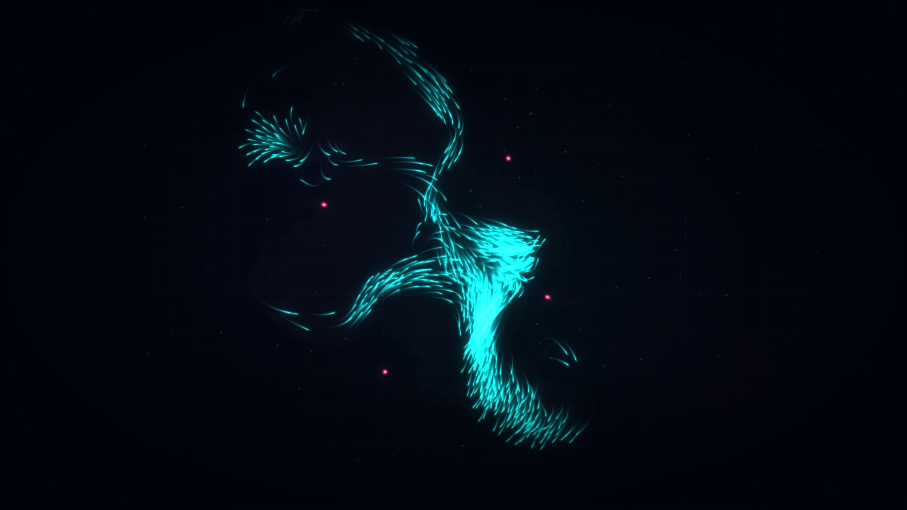<br /><b>FLIGHT</b>: lang gezogene Fluchtformation, weg von der Gefahr</td>
    <td width="33%">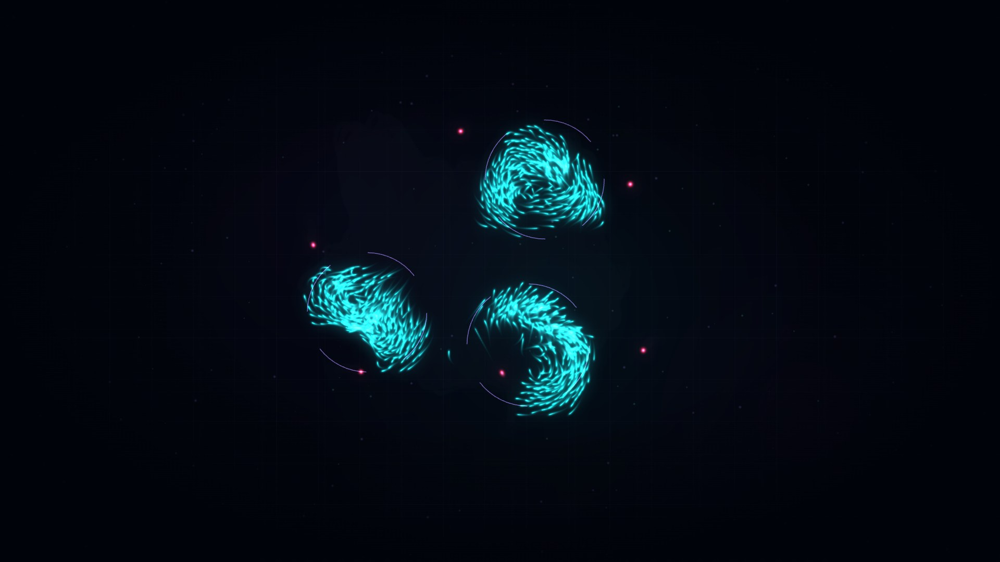<br /><b>SPLIT</b>: 2–4 Gruppen, jede reagiert auf ihren eigenen Gefahrenherd</td>
    <td width="33%">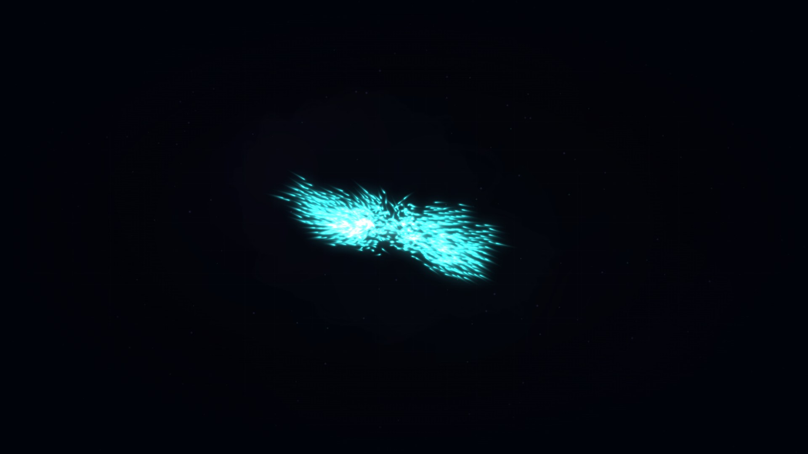<br /><b>REGROUP</b>: Verdichtung mit steigender Leuchtkraft, danach zurück zu FLOCK</td>
  </tr>
</table>

Strategiewechsel werden weich überblendet: Steering Behaviors, interpolierte Parameter und Easing statt harter Sprünge.

## Die 60-Sekunden-Demo

Ein Druck auf **`D`** startet einen vollautomatischen Ablauf, der zugleich aufgezeichnet wird. Gedacht ist er für Social-Media-Videos.

<table>
  <tr>
    <td width="33%">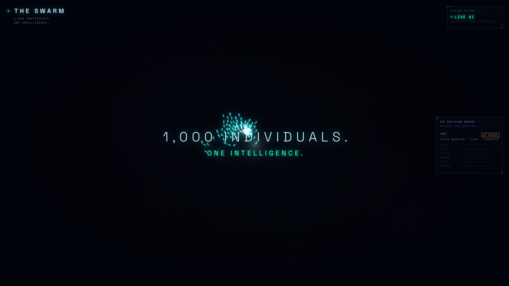<br /><b>0–8 s · Awakening</b><br />Ein Lichtpunkt teilt sich zu 1.000.</td>
    <td width="33%">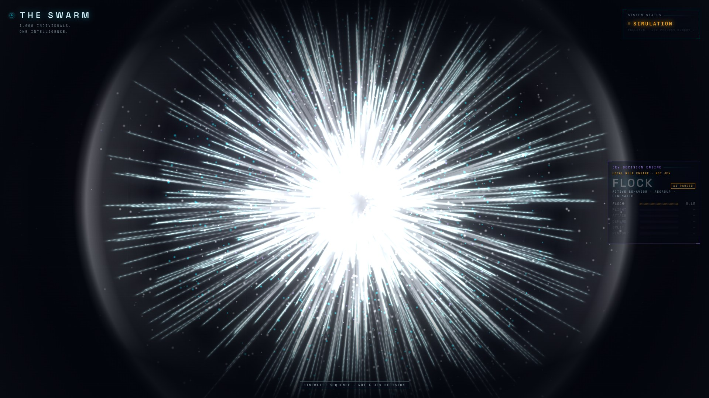<br /><b>45–55 s · The Singularity</b><br />Kollaps zur Kugel, dann Explosion in tausende Lichtpartikel.</td>
    <td width="33%">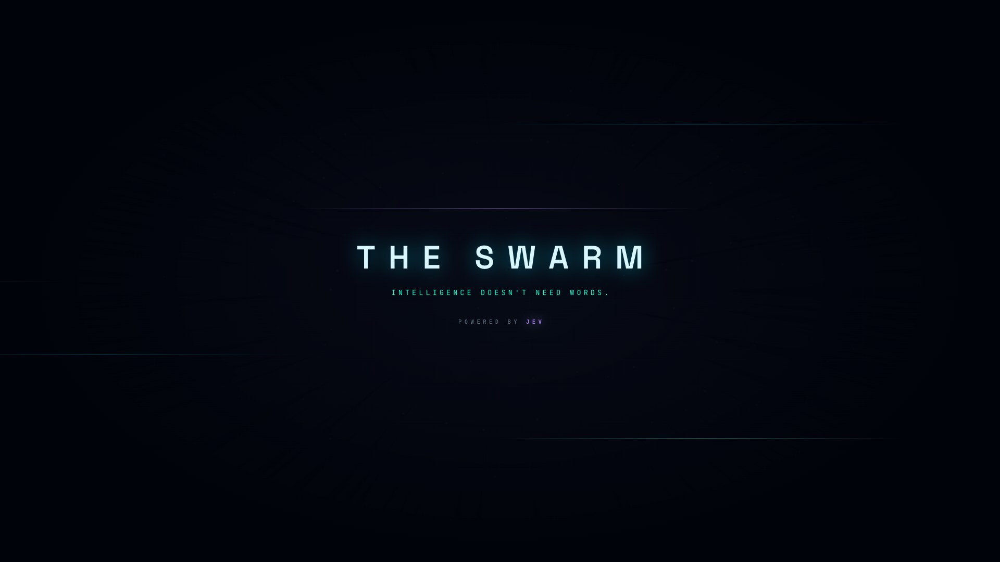<br /><b>55–60 s · End Card</b><br /><i>Intelligence doesn't need words.</i></td>
  </tr>
</table>

| Zeit | Szene | Wer entscheidet |
|---|---|---|
| 0–8 s | Awakening: Titel *1,000 INDIVIDUALS. / ONE INTELLIGENCE.* | Skript |
| 8–18 s | First Contact: eine Bedrohung erscheint | **Jev** |
| 18–30 s | Escalation: weitere Bedrohungen, Kamera zoomt heraus | **Jev** |
| 30–45 s | Chaos: 18 Bedrohungen, *CRITICAL THREAT DETECTED* | **Jev** |
| 45–55 s | The Singularity | Kinoeffekt, im HUD als *NOT A JEV DECISION* gekennzeichnet |
| 55–60 s | End Card: *POWERED BY JEV* | Skript |

## HUD

<p align="center">
  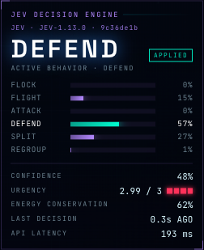
  &nbsp;&nbsp;
  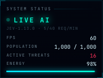
</p>

- **Modus** jederzeit sichtbar: `LIVE AI`, `SIMULATION` oder `REPLAY`
- **Wahrscheinlichkeitsbalken** für alle sechs Strategien, Confidence, Urgency, Energy Conservation, Latenz und Request-ID
- **Event Log** mit den letzten fünf Ereignissen
- **Cinematic Mode** (`C`) blendet alles Nebensächliche aus
- **Hochformat 9:16** mit eigenem Layout für Reels und Shorts

<details>
<summary><b>Hochformat-Ansicht (1080 × 1920)</b></summary>
<p align="center">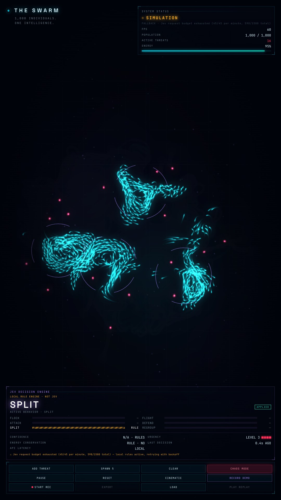</p>
</details>

## Schnellstart

```bash
git clone https://github.com/machine1986/the-swarm.git && cd the-swarm
npm install
cp .env.example .env        # TYPESAFE_API_KEY eintragen (optional)
npm run dev                 # → http://127.0.0.1:5173
```

| Befehl | Zweck |
|---|---|
| `npm run dev` | Backend (Port 8787, mit Watch) und Vite-Dev-Server (Port 5173) |
| `npm run build` | Typecheck für Client und Server, Produktionsbuild |
| `npm start` | Produktion: alles unter http://127.0.0.1:8787 |
| `npm test` | 37 Tests (Vitest) |

**Voraussetzung:** Node.js ≥ 22.18. Der Server läuft dank nativer TypeScript-Unterstützung von Node ohne Build-Schritt.

### API-Key

Einen Key bekommst du unter [console.typesafe.ai/keys](https://console.typesafe.ai/keys). Er gehört in die `.env` im Projektroot:

```env
TYPESAFE_API_KEY=...
JEV_MAX_REQUESTS_PER_MINUTE=45   # optional
JEV_MAX_REQUESTS_TOTAL=1500      # optional, pro Serverlauf
JEV_TIMEOUT_MS=6000              # optional
```

Den Key liest **ausschließlich das Backend**. Er erreicht nie den Browser und wird nie zurückgegeben. `.env` ist in `.gitignore` eingetragen.

## Steuerung

| Eingabe | Aktion |
|---|---|
| Klick auf die Bühne | Bedrohung an dieser Stelle |
| `T` / ADD THREAT · SPAWN 5 · CLEAR | Bedrohungen hinzufügen bzw. entfernen |
| `X` / CHAOS MODE | 15–20 Bedrohungen, Verdunkelung, Warnbanner |
| `Leertaste` / PAUSE | Simulation anhalten, die Oberfläche bleibt bedienbar |
| `R` / RESET | Alles zurücksetzen |
| `C` / CINEMATIC | Aufnahme-Ansicht (Esc beendet sie) |
| `D` / RECORD DEMO | 60-Sekunden-Autopilot inklusive Aufzeichnung |
| `1`–`6` | Strategie manuell erzwingen. Die KI pausiert 8 s, das HUD zeigt *MANUAL OVERRIDE · NOT JEV* |

## Wie es funktioniert

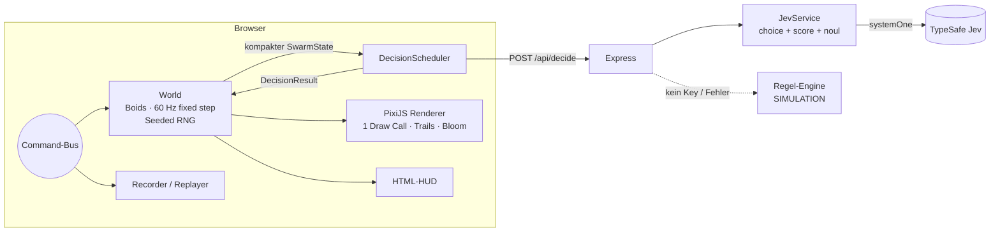

**Simulation.** Klassische Boids (Separation, Alignment, Cohesion), erweitert um Threat Avoidance, Formation Targeting und Strategy Steering. Die Nachbarsuche läuft über einen Spatial Hash, der jeden Schritt per Counting Sort neu aufgebaut wird, ohne Allokationen pro Frame.

**KI-Integration.** Ein einziger `systemOne`-Aufruf stellt drei unabhängige Fragen zum selben Zustand:

```ts
const response = await client.systemOne({
  state: swarmState,                        // ~500 Byte, keine Partikelpositionen
  questions: {
    strategy:       choice("Which swarm behavior is most appropriate…", { FLOCK: "…", FLIGHT: "…", /* … */ }),
    urgency:        score("How urgently does the swarm need to react…", ["No immediate danger…", /* … */]),
    conserveEnergy: noul("Conserving the swarm's remaining energy should take priority…"),
  },
});
```

Die Antwort wird strikt validiert. Fehlt ein Wert, wird die ganze Antwort verworfen, statt sie aufzufüllen.

**Scheduler.**
- maximal eine laufende Anfrage
- Neubewertung bei Ereignissen, mit Sperrfrist
- Cooldown für Strategiewechsel
- Verwerfen veralteter Antworten
- Request-Budget auf Client und Server
- bei Fehlern: Backoff (3 → 6 → 15 → 30 s) und so lange gekennzeichnete lokale Regeln

Die Animation läuft immer weiter.

## Record & Replay

Echte KI-Sessions aufnehmen und beliebig oft abspielen, **ohne erneute API-Aufrufe** und ohne Netzwerk-Latenz im Video.

1. `START REC` oder `RECORD DEMO`: Ein frischer Schwarm mit neuem Seed startet und wird aufgezeichnet.
2. `STOP REC`: Die Aufnahme wird automatisch als `recordings/swarm-<zeit>.json` gespeichert.
3. `LOAD` → `PLAY REPLAY`: Das HUD zeigt `REPLAY · RECORDED JEV DECISIONS`.

Reproduzierbar ist das durch einen Seeded RNG, einen festen Physik-Timestep und einen einzigen Command-Bus, über den jede Zustandsänderung läuft, mit Tick-Stempel. Ein Test prüft, dass Live-Lauf und Replay identische Positionen liefern.

### Video-Export

Eine Aufnahme lässt sich Bild für Bild zu einem Video rendern, ohne Ruckler und unabhängig davon, wie schnell der Rechner ist:

```bash
npm run dev                                              # App muss laufen
npm run render:video                                     # neueste Aufnahme → exports/*.mp4
npm run render:video -- recordings/<datei>.json --prores # zusätzlich ProRes 422 HQ für Premiere
```

- **Format:** folgt der Aufnahme. Eine Demo im Querformat ergibt 1920 × 1080, eine im Hochformat-Fenster aufgenommene Demo ergibt 1080 × 1920 für Reels und Shorts.
- **Technik:** Im Browser läuft eine virtuelle Uhr (Timer, `requestAnimationFrame`, CSS-Animationen). Jedes Bild rückt exakt 1/60 s vor, die Bilder gehen direkt an ffmpeg.
- **Ausgabe:** H.264 (CRF 16, BT.709), optional ProRes 10 Bit. Der Hinweis „Recorded Jev decisions“ wird ausgeblendet, `--keep-replay-tag` behält ihn.
- **Voraussetzungen:** Google Chrome und ffmpeg.

## Performance

| | |
|---|---|
| Partikel | 1.000 Individuen in **einem** Draw Call (`ParticleContainer`) |
| Trails | ausblendender Render-Buffer statt Partikelhistorie |
| Glow | Bloom über einen weichgezeichneten Buffer bei halber Auflösung |
| Physik | fester 60-Hz-Timestep mit Interpolation, unabhängig von der Bildrate |
| Gemessen | stabile **60 FPS** bei 1920 × 1080 in Chrome (Apple Silicon), auch mit 18 Bedrohungen im Chaos-Modus |

## Projektstruktur

```
shared/            Typen + Regel-Engine (Client & Server)
server/src/        Express-API, JevService, Request-Budget, Validierung
client/src/
  simulation/      World, SpatialHash, RNG, Metriken, Strategien
  rendering/       PixiJS: Schwarm, Bedrohungen, Effekte, Hintergrund, Kamera
  api/             API-Client, DecisionScheduler
  hud/             HUD und Overlays (HTML/CSS)
  demo/            Autopilot-Skript
  replay/          Recorder / Replayer
docs/screenshots/  Bilder für diese README
recordings/        gespeicherte Sessions (nicht eingecheckt)
```

## Bekannte Einschränkungen

- Eine Aufnahme beginnt immer mit einem frischen Schwarm.
- Replays sind im selben Browser deterministisch. Über verschiedene JS-Engines hinweg ist das nicht garantiert. Rein visuelle Funken können minimal abweichen.
- Einen direkten Videoexport gibt es nicht. Aufgenommen wird mit OBS bzw. per Bildschirmaufnahme.
- Schriften kommen von Google Fonts. Offline greifen die Systemschriften.

## Lizenz

[Apache License 2.0](LICENSE). Siehe auch [NOTICE](NOTICE). Die Namen „KI Boost Mittelstand“ und „dotnet Services GmbH“ sind von der Lizenz nicht umfasst.

---

<div align="center">

## Über uns

<a href="https://www.kiboostmittelstand.de"><b>KI Boost Mittelstand</b></a><br />
<i>Die rechte Hand, die Sie nie eingestellt haben.</i>

THE SWARM zeigt, was entsteht, wenn viele einfache Teile von einer klugen Entscheidungsinstanz geführt werden.<br />
Genau das bauen wir für den Mittelstand: KI-Assistenz, die Büroarbeit übernimmt, mit festem Preis, festem Ergebnis und festem Zeitrahmen.

**[www.kiboostmittelstand.de →](https://www.kiboostmittelstand.de)**

<sub>KI Boost Mittelstand ist eine Marke der dotnet Services GmbH.</sub>

</div>
